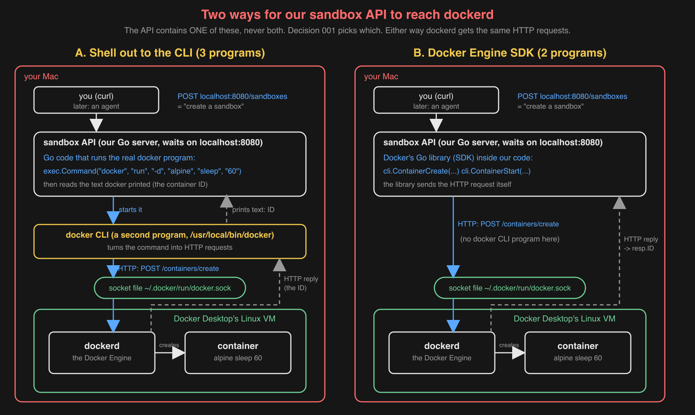

# 001: How the sandbox API talks to Docker: Engine SDK or the `docker` CLI

- Date: 2026-10-24 (L0 day 2)
- Decided by: Ritika Gupta (Stage A: options and recommendation by Claude, challenged and decided by Ritika)
- Status: accepted

## Context

The sandbox API is a Go server on the Mac (`localhost:8080`). It receives "create / list / exec / delete a sandbox"
requests and must get `dockerd` (inside Docker Desktop's Linux VM) to do each one. `dockerd` takes orders only as
plain HTTP requests on a Unix socket file (here `~/.docker/run/docker.sock`; `/var/run/docker.sock` does not exist on
this Mac, OBSERVED).

The picture this decision was made from (Ritika's draft of the two routes, completed by Claude):

## Options

- **A. Shell out to the CLI.** The API starts the real `docker` program (`exec.Command("docker", "run", ...)`) for every
  request and reads the text it prints. Three programs per request: API → `docker` CLI → `dockerd`.
- **B. Docker Engine SDK.** Docker's Go library inside the API sends the HTTP requests itself
  (`ContainerCreate`, `ContainerStart`) and returns Go values. Two programs: API → `dockerd`.

| Question | A. CLI | B. SDK |
| --- | --- | --- |
| Speed | starts a new `docker` program per call (one `docker version`: 115 ms total, OBSERVED, 1 run) | one HTTP request, no new program (INFERENCE: faster) |
| Reading answers and errors | printed text to cut apart; breaks if the CLI's wording or format changes | Go values (`resp.ID`) and error kinds ("not found") |
| Crash of the API mid-call | can leave a half-done `docker` child behind | one process |
| Debugging | log the exact command; paste it into a terminal | log each call (method, container ID) |
| Setup | needs only the `docker` binary | a Go dependency, and `DOCKER_HOST` set on this Mac |
| Second runtime (smolvm, L7) | smolvm also has a CLI | smolvm library or API: UNKNOWN |

## Decision: B, the Engine SDK

Why (Ritika):

- **Faster:** A starts an extra program, the `docker` CLI, for every request; B doesn't.
- **More reliable:** B gets answers and errors as ready-made values. A has to cut them out of the CLI's printed text,
  so it breaks if the CLI's wording or format changes.
- **Setup is a one-time cost:** adding the library and setting `DOCKER_HOST` happens once.
- **Debugging:** B's error kinds (e.g. "not found") help, and the API logs each Docker call it makes (what it asked
  for, the container ID), since there is no command to paste into a terminal.

## What would change this decision

- smolvm turns out reachable only through its CLI, and keeping both runtimes the same matters more than speed.
- The flip (module loop step 8): rerun today's create-latency experiment with A. If A's extra cost is small next to
  container creation itself, speed stops being a reason.

## Spike

Not run before deciding (Ritika decided from the trade-offs). The step 8 flip measures A against B on the same
experiment instead.

## Flip result (2026-10-24, same day): B stays

50 creates through the API with each route, same machine (`results/l0-create-latency.csv`):

| | min | p50 | p99 |
| --- | --- | --- | --- |
| B, Engine SDK | 76 ms | 100 ms | 129 ms |
| A, `docker` CLI | 111 ms | 128 ms | 162 ms |

Why B stays (Ritika):

- With A, every create starts an extra program, `docker`, which loads, reads its settings to find the socket, sends
  the requests and exits; the create and start themselves happen in `dockerd` either way (INFERENCE on where the time
  goes; not timed piece by piece).
- That costs +28 ms (+28%) at p50, and A's fastest create (111 ms) is slower than B's median (100 ms), so the gap is
  real, not noise (OBSERVED).
