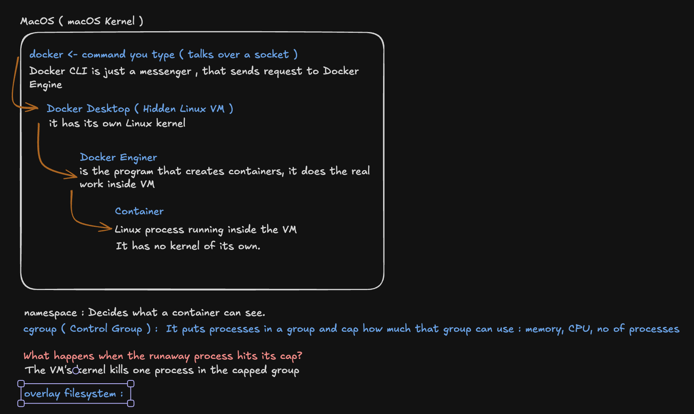

# L0 day 1: see it (Thu 2026-10-22)

What a Docker container is, looked at from inside the container and from the VM it runs in.
Setup: macOS arm64, Docker Desktop 28.1.1 (hidden Linux VM: 4,109,803,520 bytes RAM, 8 CPUs), `alpine:latest`.
Ritika ran every command; Claude wrote them and explained each term first.

## Rerun

```bash
docker run -d --name l0box alpine sleep 3600
docker exec l0box ps                                     # the container's own process list
ps aux | grep -v grep | grep "sleep 3600"                # the Mac's list: nothing
docker run --rm --pid=host alpine ps | grep -E "PID|sleep 3600"   # the VM's list
P=<sleep's PID in the VM>
docker run --rm --privileged --pid=host alpine sh -c "for n in pid mnt net uts ipc cgroup user; do echo \"\$n  container: \$(readlink /proc/$P/ns/\$n)   VM: \$(readlink /proc/1/ns/\$n)\"; done"
docker exec l0box cat /sys/fs/cgroup/memory.max /sys/fs/cgroup/memory.current
docker run --rm -m 256m alpine cat /sys/fs/cgroup/memory.max
docker run --rm -m 64m --memory-swap 64m alpine sh -c 'head -c 200m /dev/zero | tail > /dev/null'; echo "exit code: $?"
docker exec l0box sh -c 'echo hi > /hello.txt' && docker diff l0box
docker run --rm alpine ls /hello.txt
docker run --rm --privileged --pid=host alpine nsenter -t 1 -m -- ls -la $(docker inspect l0box --format '{{.GraphDriver.Data.UpperDir}}')
```

## Results (all OBSERVED)

| Look | Result |
| --- | --- |
| Processes, from inside | 2: `sleep 3600` as **PID 1**, and `ps` |
| Processes, from the Mac | none: the container lives inside Docker Desktop's Linux VM |
| Processes, from the VM | `sleep 3600` is **PID 614**; the VM runs ~159 processes. One process, two numbers |
| Namespaces vs the VM's PID 1 | 6 of 7 differ (`pid`, `mnt`, `net`, `uts`, `ipc`, `cgroup`); **`user` is shared**: container root is the VM's real root |
| Memory cap, plain `docker run` | `memory.max` = `max` (none); using 1,925,120 bytes |
| Memory cap, `-m 256m` | 268,435,456 (256 MiB) |
| Over the cap (64 MiB, tries 200 MiB) | `Killed`, exit 137 (128 + SIGKILL); `l0box` and the VM unaffected |
| Files | write in `l0box` → `docker diff`: `A /hello.txt`; fresh container: no such file; the file sits in `l0box`'s own top layer, `/var/lib/docker/overlay2/<id>/diff/hello.txt` (3 bytes) in the VM |

## What it means (Ritika's answers, corrected together)

- A **container** is an ordinary Linux process with fences, on a shared kernel. On a Linux host the host's `ps` sees it;
  on a Mac it's hidden only because it runs inside Docker Desktop's VM.
- **Namespace:** the kernel shows the same process under a separate numbered list ("only 1 sleep process; the kernel just
  shows the processes inside that container as a separate numbered list"). Each kind fences one thing.
- Shared `user` namespace: root inside is real root in the VM. A container with its fences off (our `--pid=host
  --privileged` helper) sees and can kill every process.
- **cgroup:** caps what a group of processes may use. Docker puts each container in one but leaves the caps at `max`
  unless asked, so a sandbox API must set the caps on create. Over the cap, the kernel kills a process in that group only.
- **Overlay filesystem:** the image's read-only layers are shared; each container writes to its own top folder, deleted
  with the container (volumes are separate and survive).
- Ritika's mind map of the Docker look: 
- **Orphan** (hook for Friday's break): if the API dies and never deletes a container, the whole container stays: the
  running process and its memory, its cgroup and namespaces, its top folder.

## Docker vs smolvm (smolvm 1.30.1, same `alpine` image, `sleep 3600` as the job)

```bash
uname -r                                   # the Mac
docker run --rm alpine uname -r            # Docker Desktop's VM
smolvm machine create --name l0vm --image alpine -- sleep 3600
smolvm machine start --name l0vm
smolvm machine exec --name l0vm -- uname -r
smolvm machine exec --name l0vm -- ps
ps aux | grep -v grep | grep -E "smolvm-bin|sleep 3600"
```

| | Mac | Docker container | smolvm machine |
| --- | --- | --- | --- |
| Kernel (`uname -r`) | 25.6.0 (macOS) | 6.10.14-linuxkit (shared with every container in Docker Desktop's VM) | 6.18.55 (its own) |
| `sleep`'s PID inside | — | 1 | 2 (PID 1 is smolvm's `/run/smolvm/init container-init`) |
| What the Mac's `ps` shows | — | nothing (it's in Docker's VM) | one `smolvm-bin _boot-vm` process (PID 31161), no `sleep` |

Prediction (unscored): 3 different kernels, (c). Right.

- `l0box` stopped by itself after an hour: its `sleep 3600` (PID 1) ended, and a container lives only as long as its PID 1.
  Ritika: "the process completed, there's no other running process inside the container so the container stopped."
  Correction: it's PID 1 that counts; when PID 1 exits, the rest of the container is killed too (more in L1).

## Startup latency: a throwaway sandbox that runs `true` (10 runs each, 1 warm-up not counted)

Rerun: `python3 measure_startup.py` (Docker and smolvm), `python3 measure_startup.py 10 smolvm-no-registry`.
Raw numbers: `startup_results.csv`. Predictions: `predictions.md` #1–3 (score 2 / 3).

| Command | min | median | max |
| --- | --- | --- | --- |
| `docker run --rm alpine true` | 179 ms | **203 ms** | 240 ms |
| `smolvm machine run --image alpine -- true` (default: registry check every run) | 3,295 ms | **4,022 ms** | 4,515 ms |
| same with `--seed-digest-ttl 3600` (registry check skipped) | 1,339 ms | **1,754 ms** | 4,102 ms |

- OBSERVED: smolvm's default is ~20× Docker's. Skipping the per-run registry check saves ~2.3 s of the 4.0 s median.
- OBSERVED: run 1 of the no-registry set (4,102 ms) looks like a full check; why the warm-up didn't cover it is UNKNOWN.
- INFERENCE: the kernel boot is not the main cost (Monday: `start` of a machine made with `create --from` a packed
  `.smolmachine`, kernel boot included, took 0.6 s). Monday timed only `start`; today's numbers are the whole trip
  (create, run `true`, delete), so the remaining ~1.1 s is UNKNOWN: create/delete steps, setting up the image's disk, or
  both. Saturday's measurement (boot from image vs `create --from` vs `branch`) must time the same full trip for all three.

## `docker exec` = `nsenter` done by the engine

`nsenter -t <PID> -m -p … -- CMD`: ask the kernel (`setns`) to move into the namespaces of process `<PID>` (looked up on
your own process list), only the kinds named (`-m` files, `-p` process list), then run CMD. Our VM-folder `ls` needed it
because the helper's own file view had no `/var/lib/docker`; `--pid=host` had already given it the VM's process list.

```bash
docker run -d --name l0box2 alpine sleep 600
docker exec l0box2 ps
docker run --rm --privileged --pid=host alpine nsenter -t $(docker inspect -f '{{.State.Pid}}' l0box2) -p -m ps
docker rm -f l0box2
```

OBSERVED: both show the same world (`sleep 600` as PID 1, plus `ps`); `ps` is PID 7 via `docker exec`, PID 13 via
`nsenter`: a new process takes the next free number on the container's list, and other short-lived processes used
numbers in between (which ones: UNKNOWN, not traced).

### The 3 steps, as a room (taught after Ritika: "what do u mean when u say docker exec is nsenter into container's view?")

Picture: `l0box2` is a room; on its wall hangs the room's own numbered list (its `pid` namespace), `sleep` is #1. The
terminal, the Docker engine and the helper are outside, reading the VM's big list. A new process is born where its parent
is, so outside. To make `ps` read the room's list:

1. **Find the room:** which process is the container? `sleep`, known outside by its VM number (`docker inspect -f '{{.State.Pid}}'`).
2. **Walk into the room:** ask the kernel to move into the same namespaces as that `sleep` (`setns`).
3. **Run `ps` in there:** it reads the room's list: `sleep` is #1, and `ps` takes the next free number on that list.

`docker exec` does all 3 (you give only the name); `nsenter` does 2 and 3 (you do 1 with `docker inspect`).

Q: which step makes `ps` see `sleep` as #1? Ritika: "step 2, since ps walked into the same room (pid namespace) where
sleep exists, so it was able to see sleep as #1." Right. (Her earlier "ps gets its own free pid": true of every new
process; what matters is which list the number comes from, and that is decided by step 2.)
