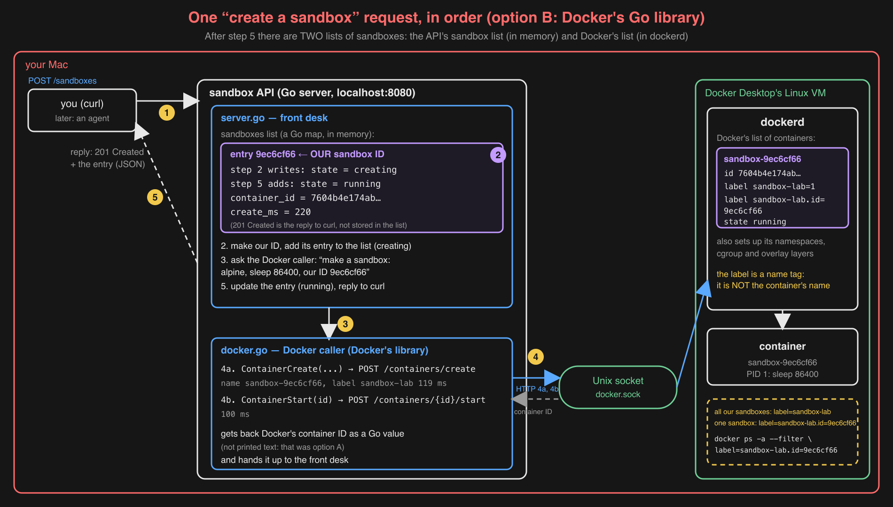

# L0 day 2 (Sat 2026-10-24): build and break

Failure question: "What does 'create a sandbox' actually do, and how long does it take?"
Day 1 record: `day1-see-it.md`.

## Cold recall (5 min, no notes)

1. **What does the memory cgroup do when a container goes over `memory.max`?** Ritika: "kills a process in that cgroup.
   It returns an exit code of 137. The process sees that there's no memory." Kill and 137 right. Fixes: the process
   sees nothing; it gets `SIGKILL`, which can't be caught. 137 = 128 + 9 (`SIGKILL`). Missing: neighbours (`l0box`)
   and the VM survive; the fence keeps one sandbox's runaway memory inside it.
2. **Docker container vs smolvm machine for untrusted code?** Ritika: shared Docker Desktop VM kernel vs own kernel;
   container is a fenced process so it starts fast, the VM isolates more but "kernel bootup increases latency".
   Kernel and trade-off right. Fixes: she gave her prediction ranges (100–500 ms, 0.5–2 s), not the measured medians
   (203 ms; 4,022 ms default, 1,754 ms without the registry check). The kernel boot is not the main cost (INFERENCE from
   day 1: the registry check is ~2.3 s of 4.0 s; Monday's `start` with kernel boot took 0.6 s; ~1.1 s UNKNOWN, measured
   Sunday). Missing: the risk side: one kernel bug or removed fence reaches every container and the VM; a smolvm escape
   must break its own kernel and the hypervisor.
3. **Which namespace kind did `l0box` not get?** Ritika: "user ... container's root user is the VM's real root user."
   Right.

Score: 1 right, 2 partly right. To pull back next time: the measured numbers, and why smolvm is slow.

## Decision 001: Engine SDK vs the `docker` CLI

Ritika drew the two routes from the API to `dockerd` first; Claude completed the map (socket, VM, the CLI as a second
program, the reply paths). She decided from it: **B, the SDK**. Record: `../../decisions/001-docker-sdk-vs-cli.md`.

## Build: the sandbox API (Claude wrote it, to decision 001)

Run: `go run ./cmd/sandbox-api` (listens on `localhost:8080`). Code: `cmd/sandbox-api/main.go` (starts it),
`internal/api/server.go` (HTTP requests and the in-memory sandbox list), `internal/runtime/docker.go` (Docker SDK calls),
`internal/runtime/runtime.go` (the interface smolvm will also fill in L7). Every container gets the label `sandbox-lab`,
so leftovers show with `docker ps -a --filter label=sandbox-lab`.

Smoke test (OBSERVED, 2026-10-24): create → `running` in 220 ms (create 119 ms + start 100 ms); exec of
`ps; uname -r; echo oops >&2; exit 3` → `sleep 86400` is PID 1, kernel `6.10.14-linuxkit`, stderr `oops`, exit code 3;
delete → 204, second delete → 404; 0 containers left.

Build note: Docker's Go library v28.1.1 has no `go.mod` of its own, so Go picked the newest versions of its
dependencies, which don't fit it (`sockets.DialPipe` missing) and need Go 1.26. Fixed by pinning the versions
Docker 28.1.1 itself uses (`go.mod`).

### One create request, in order (Ritika's draft, completed by Claude)

1. `POST /sandboxes` arrives at the front desk (`server.go`).
2. The front desk makes **our** sandbox ID and adds an entry for it to its in-memory sandbox list: `creating`.
3. It asks the Docker caller (`docker.go`) to make the sandbox.
4. The Docker caller sends two HTTP requests over the socket: create (named `sandbox-<id>`, label `sandbox-lab`), then
   start. `dockerd` returns **Docker's** container ID, as a Go value.
5. The front desk updates the entry (`running`, container ID, `create_ms`) and replies `201 Created` with it.

Two IDs (ours, Docker's) and two lists (the API's sandbox list in memory; Docker's container list in `dockerd`).
Find them without the API: all ours `docker ps -a --filter label=sandbox-lab`; one sandbox
`docker ps -a --filter label=sandbox-lab.id=9ec6cf66`.

## Measure: create latency through the API (50 runs, 1 warm-up)

Rerun: `python3 measure_create.py` (starts the API if needed). Raw numbers: `../../results/l0-create-latency.csv`.

| | min | p50 | p99 (≈ slowest of 50) |
| --- | --- | --- | --- |
| client time, `POST /sandboxes` | 76 ms | **100 ms** | 129 ms |
| Docker create + start inside the API | | 98 ms | |

- OBSERVED: the API's own overhead (HTTP, JSON, its list) is 2.2 ms at p50; Docker's create + start is almost all of it.
- OBSERVED: p99/p50 = 1.29: runs are close together; nothing slow (like smolvm's registry check) happens per run here.
- OBSERVED: 0 containers left with label `sandbox-lab` after 50 create + delete.
- Predictions 4 (c 200–400 ms) and 5 (b 1.5–3×): both wrong; score 2 / 5.

## Break: kill the API while 5 sandboxes exist

Rerun: `python3 break_kill_api.py`. Raw: `../../results/l0-kill-api-orphans.csv`.

| Step | OBSERVED |
| --- | --- |
| 1. create 5 through the API | 5 × `201` (first 280 ms, then 98–100 ms) |
| 2. kill the API (SIGKILL) | API stops answering |
| 3. Docker, label `sandbox-lab` | **5 containers, 5 running** |
| 4. restart the API, `GET /sandboxes` | `200`, **0 sandboxes** |
| 5. `DELETE /sandboxes/dee5ac04` (ID kept by the caller) | **`404 no such sandbox`** |
| 6. Docker at the end | 5 containers, 5 running: **5 orphans** |

Predictions 6 (b) and 7 (b) right, 8 (a) wrong; score 4 / 8.
