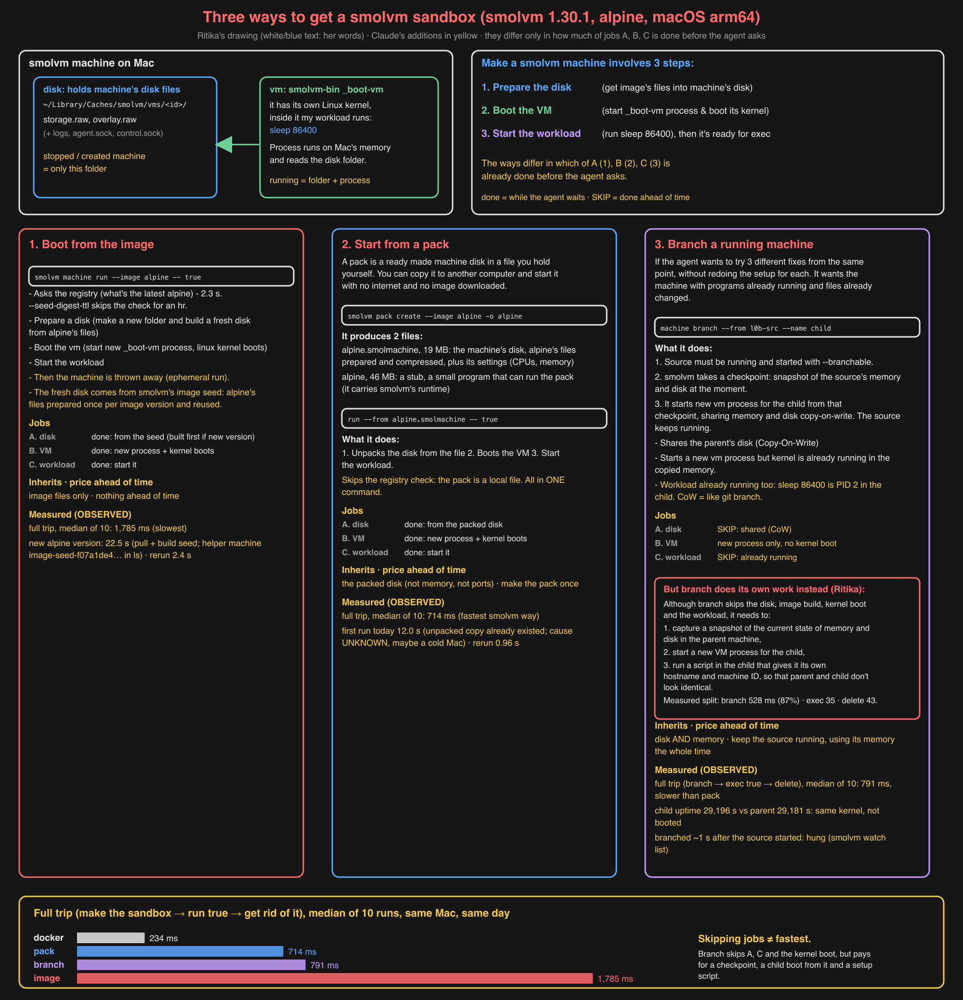

# L0 day 3 (Sun 2026-10-25, started the evening before): three ways to get a smolvm sandbox

Question: "create a sandbox" in smolvm can mean boot from an image, start from a packed file, or branch a running
machine. What does each one do, skip and inherit, and what does each cost over the same full trip?

## Re-walk (Ritika at the keyboard; smolvm 1.30.1, alpine)

A smolvm machine is a **folder** (its disk, `~/Library/Caches/smolvm/vms/<id>/`) plus, while running, a **process**
(`smolvm-bin _boot-vm`, the VM, own Linux kernel) that reads that folder. `smolvm machine ls` listed 12 machines and
`ps` showed one `_boot-vm` process: only `l0b-src` was running; created and stopped machines are only a folder.
Making a sandbox is three jobs: **A** prepare the disk, **B** boot the VM, **C** start the workload. The three ways
differ only in how much of A, B, C is done ahead of time.

| Way | OBSERVED by Ritika |
| --- | --- |
| 1. `machine run --seed-digest-ttl 3600 --image alpine -- true` | 22.5 s: a new alpine version had been published, so smolvm pulled it and built a new **image seed** (helper machine `image-seed-f07a1de42a94bad1-17345` appeared in `ls`; seed folder `image-seeds/f07a1de4…` created 13:06). Rerun: 2.4 s. The sandbox itself was `vm-e83c7a7c`, thrown away after `true` |
| 2. `machine run --from alpine.smolmachine -- true` | first run 12.0 s; the pack's unpacked copy (`~/Library/Caches/smolvm-pack/d3f5a4cb`) already existed from Oct 24, so not unpacking (cause UNKNOWN; candidate: cold Mac after idle). Rerun: 0.96 s |
| 3. `machine branch --from l0b-src --name l0b-mine` | child `/proc/uptime` 29,196 s vs parent 29,181 s: the same kernel, carried on from the checkpoint, not booted; `sleep 86400` already PID 2 in the child; the child has its own VM process (PID 20251); `delete -f` stopped it and removed its folder |

Ritika's drawing, completed by Claude (all her text kept; additions in yellow):

Lesson on method: every way had a slow first run (Docker 2.2 s, image 22.5 s for a new version, pack 12 s); the
measurement throws away one warm-up per way.

## Measure: the same full trip for all four ways (10 runs each, 1 warm-up)

Rerun: `python3 measure_smolvm_ways.py`. Raw: `../../results/l0-smolvm-three-ways.csv`.

| Way | min | median | max |
| --- | --- | --- | --- |
| docker (`docker run --rm alpine true`) | 193 ms | **234 ms** | 329 ms |
| pack (`run --from alpine.smolmachine -- true`) | 605 ms | **714 ms** | 911 ms |
| branch (`branch` → `exec true` → `delete`) | 731 ms | **791 ms** | 833 ms |
| image (`run --seed-digest-ttl 3600 --image alpine -- true`) | 1,309 ms | **1,785 ms** | 2,006 ms |

OBSERVED: branch, which skips jobs A and C and the kernel boot, was slower over the full trip than pack, which does
all three. Predictions 10 right, 11 and 12 wrong.

## Why is branch slower than pack? Split its trip (10 runs, fresh source, 1 warm-up)

Rerun: `python3 measure_branch_steps.py`. Raw: `../../results/l0-branch-steps.csv`.

| Step | median |
| --- | --- |
| `machine branch` | **528 ms** (87% of the trip) |
| `machine exec <child> -- true` | 35 ms |
| `machine delete -f <child>` | 43 ms |
| control: `machine exec <source> -- true` | 28 ms |
| sum of the three | 606 ms |

- OBSERVED: almost all of branch's cost is the `branch` command itself; running three separate commands instead of
  one adds little (exec 35 ms, delete 43 ms).
- What `branch` does that pack doesn't (from its output and the child's log): take a checkpoint of the running
  source's memory and disk, boot the child from it, then run a setup script in the child (new hostname, machine-id,
  forkpoint marker) so it doesn't look identical to its parent. Branch skips A, C and the kernel boot but pays for
  this instead. Which part costs most: UNKNOWN (not split further).
- Not explained: this trip sums to 606 ms vs 791 ms in the four-way run; the source differed (fresh here, running
  since Oct 24 there). Cause UNKNOWN.
- SOURCE (`machine branch --help`): `--freeze-source` reuses one checkpoint for later branches and `--hold` keeps
  pre-booted children in a pool. Both aim at exactly this cost; not measured.
- On the way: the first try branched ~1 s after the source started and hung (smolvm watch list, Monday).
- Predictions 13 and 14 right; score 8 / 14.

**Explain-back (Ritika, no notes):** "Branch is not automatically the fastest. Although it skips the disk, the image
build, the kernel boot and the workload, it needs to capture a snapshot of the current state of memory and disk in the
parent machine, start a new VM process for the child, and run a script in the child that gives it its own hostname and
machine ID, so that parent and child don't look identical." Right; it's now in the map (Way 3, red box, and the
results strip).
