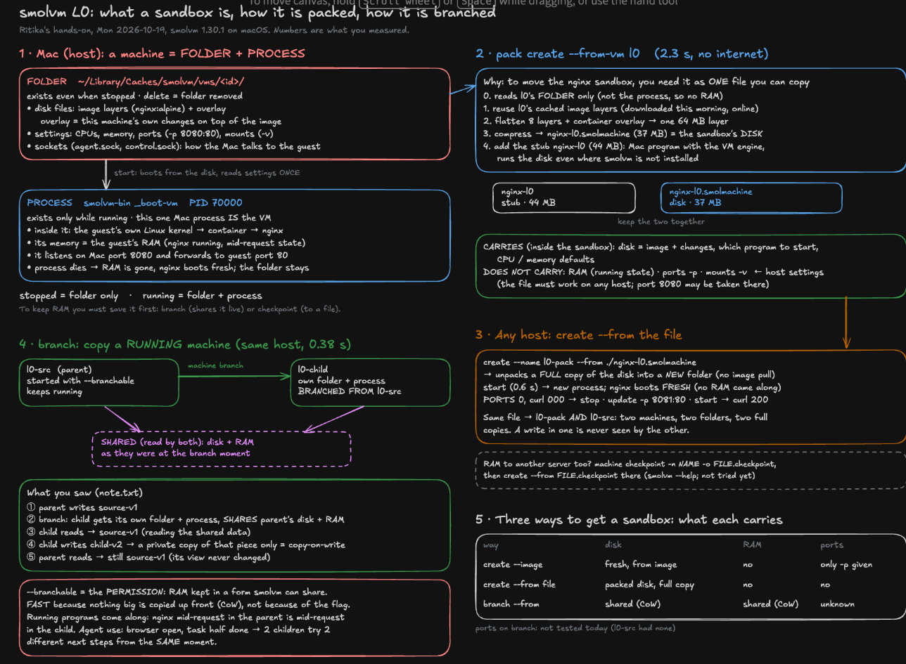
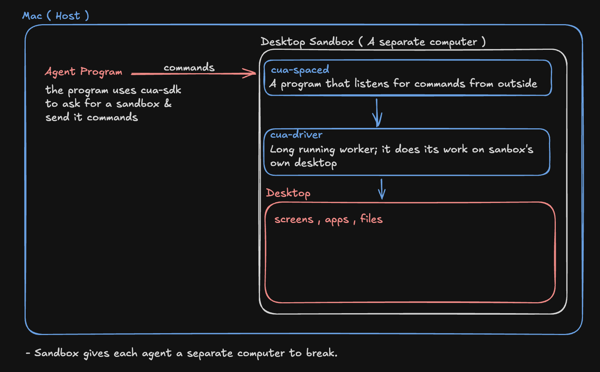

# L0 topic looks: what is a sandbox?

Reading/hands-on notes from the contributor days (OPERATING §2). The lab uses these as real examples.

## smolvm (Mon 2026-10-19, hands-on, smolvm 1.30.1 on macOS arm64)

Question: what does `machine run`/`start` create on the host, and what isolates it?

- **Processes:** one host process per machine, `smolvm-bin _boot-vm <data-dir>/boot-config.json` (PID 70000, ~14 MB RSS).
  The guest's processes (init as PID 1, nginx master and workers) are invisible to the Mac's `ps` (OBSERVED).
- **Disk:** a per-machine folder `~/Library/Caches/smolvm/vms/<id>/`, owned by the user: sparse disk images
  `storage.raw` (20 GiB apparent) and `overlay.raw` (10 GiB), 78 MB actually used; logs; Unix sockets
  `agent.sock`, `control.sock`, `ports.sock` for host↔guest control (OBSERVED; roles of the sockets from names, INFERENCE).
- **Network:** the guest has its own stack (`eth0` 100.96.0.2/30, own `lo`). `-p 8080:80` → the VM process itself listens
  on host 127.0.0.1:8080 and [::1]:8080 and relays into guest port 80 (OBSERVED). Outbound `--net` goes through virtio-net
  with the VM process opening host sockets (INFERENCE from #1833; not traced).
- **Isolation:** a separate Linux kernel behind hardware virtualization (Hypervisor.framework via libkrun); the workload
  runs in a container inside that guest (PID 1 `container-init`). Deliberate openings: forwarded ports, mounts, `exec`.
- Ritika, in her words: "a process is the vm (smolvm machine) running on mac that has PID 70000 · disk is a folder in
  Mac which has logs, sockets that guest needs for talking to Mac · the vm machine starts a container inside where nginx
  runs. VM uses its own Linux kernel."
- For Thursday: compare with a Docker container (shared kernel; on a Mac, inside Docker Desktop's own VM).
- **Afternoon, pack and branch** (MAP Use log has the numbers): a sandbox is also an *object*. `pack create --from-vm`
  turns a machine into one 37 MB `.smolmachine` (its disk: image layers + changes) plus a 44 MB stub that runs it; a new
  machine starts from it in 0.6 s with no pull. Host-side settings (port 8080) do not travel; the host re-adds them.
  `machine branch` clones a running `--branchable` machine in 0.38 s; the child starts with the parent's state, and its
  writes stay private (copy-on-write) (all OBSERVED). For the lab: "create a sandbox" can mean boot from an image, start
  from a packed file, or branch a live one; each has a different cost to measure.
- Ritika, in her words (pack/branch explain-back, after a 4-piece re-walk): "smolvm sandbox is a vm ( guest machine ) that
  can be copied into another server, it can be branched so that agent can try out different things , it can be a running
  process on your own mac, it gets transferred as a file." Follow-up, on the Mac: "the folder ( the disk ) that contains
  settings , socket , for the process running". What each way carries (her table, corrected together):
  | Way | Disk | RAM | Host settings (ports) |
  | `create --image` | fresh, from the image | no | only what you pass (`-p`) |
  | `create --from` `.smolmachine` | yes, the packed disk | no | no |
  | `branch --from` | yes, shared by CoW | yes, shared by CoW | UNKNOWN (source had no ports; not tested) |
- Mind map of the whole afternoon (Ritika's draft, corrected together): 
  Editable: [pack-branch-map.excalidraw](pack-branch-map.excalidraw) (Excalidraw → menu → Open; it replaces the open canvas).

## CUA (Tue 2026-10-20, reading only, origin/main 9bd1d8b76)

Question: what is CUA's desktop sandbox (container or VM), and how is it started?

- **Why it exists:** an agent that uses a computer needs one. Running the Cua Driver on your own Mac lets the agent click
  your real apps, delete your real files, and two agents fight over one screen. A desktop sandbox gives each agent its
  own separate computer: its own desktop, a small program inside (`cua-spacesd`, port 3211) that receives commands from
  outside, and Cua Driver inside it clicking on that box's own screen. You write an agent program that uses the cua SDK
  to create boxes and send them commands (SOURCE: `docs/content/docs/cua-sdk/concepts/how-sandboxes-work.mdx`).
- Ritika's map of the picture: 
- **Container or VM: both, picked from the image** (SOURCE: `libs/cua/crates/cua-vmm/src/auto.rs`):
  macOS image → VM with Lume (Apple silicon only) · Linux/Windows disk image → VM with QEMU · Linux container image →
  container: gVisor if the Docker engine has it (or may install it), else runc and it reports `isolation: runc`; no
  Docker engine → CUA starts its own small Linux VM (`cua-runtime`). Override with `--kind` / `--runtime`.
- **Layers one request passes through, on a Mac** (top = program in the box):

  | gVisor | runc | QEMU | Lume |
  | --- | --- | --- | --- |
  | box's own Sentry (fake kernel) | — | box's own Linux/Windows kernel | box's own macOS kernel |
  | hidden Linux VM's kernel (shared) | hidden Linux VM's kernel (shared) | QEMU (fake computer) | Lume (Apple's VM framework) |
  | hypervisor → Mac | hypervisor → Mac | hypervisor → Mac | hypervisor → Mac |

  On a Mac even containers live in a VM: containers need a Linux kernel, the Mac's kernel is macOS.
- **Started and stopped:** `cua sb create` / `Sandbox.create(...)` (until deleted) or `Sandbox.ephemeral(...)` (deleted
  when the code block ends). Ready = the runtime says running and every declared probe passes; no agent inside is
  required. Disconnecting never stops a box. Several boxes at once: one SDK handle per box; `cua daemon` lets several
  local programs share them. UNKNOWN (not read): how a command physically reaches each box's door (port, tunnel).
- **Spike link:** `cua-vmm/src/cleanup.rs` undoes a cancelled create from a drop guard, and says that at process exit
  "nothing runs" — the same weakness as #5588 (cleanup inside a program can't run once it dies). A crashed agent
  program leaves its `create`d boxes running.
- **vs smolvm (Monday):** smolvm = always a VM (own kernel, libkrun, one host process per machine). CUA = container or VM
  by image; its containers share a kernel unless gVisor puts a private fake kernel in front.
- Ritika, in her words: "the agent program on my Mac uses the cua SDK, a library provided by cua, to ask for a
  sandbox; inside the sandbox there's a whole desktop of its own; cua-spacesd is a small program inside the sandbox
  that listens for commands from outside; Cua Driver does the real work." Why a sandbox: "running it on your own device
  allows the agent to click real apps, delete your real files; 2 agents can't work at the same time without fighting
  over one screen." Kernels: "a VM has its own kernel, while a container uses a shared kernel"; gVisor and runc share a
  kernel, QEMU and Lume have their own. Box 2 crashing: "box 1 and box 3 don't get affected; each box is a separate
  computer with its own cua-spacesd and its own driver." Refinement: true for a normal crash; with gVisor/runc the boxes
  still share the hidden VM's kernel, so only a crash that breaks that shared kernel would reach the others (VMs don't
  share it).
- For Thursday: look inside a container from the hidden VM's side (`ps`, namespaces, cgroups) and compare with a smolvm
  machine; that is where "shared kernel" becomes visible.
